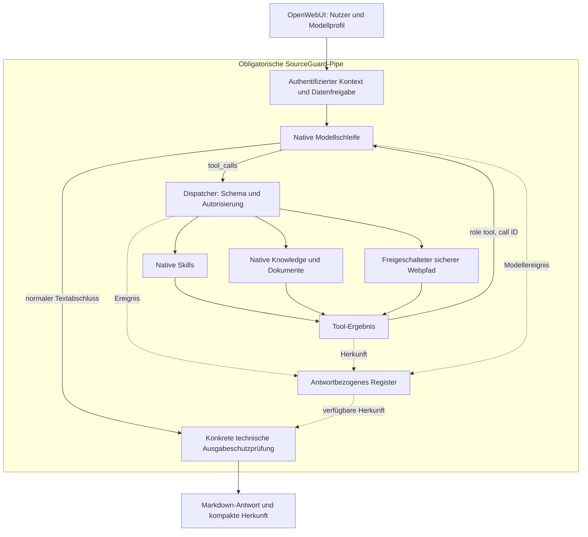

# THEOAgent v2 – Zielarchitektur (AP2.4)

Stand 28.11.2026 | SE-Entwurf zur unabhängigen QE-Prüfung | Ausgangscommit e0c32023c7a70e69544cd164c3f374c31b3e9543. Keine Produktfreigabe, kein Implementierungsnachweis.

## 1. Entscheidung und Geltungsbereich

Eine obligatorische SourceGuard-Pipe im vorhandenen OpenWebUI (Referenz 0.11.4). Native Modellkommunikation über generate_chat_completion, zunächst google/gemma-4-31b-it direkt über OpenRouter. Native Skill-/Knowledge-Callables; sichere Webadapter nach Schutzvalidierung. Modell und Provider austauschbar innerhalb des Plattformvertrags, Requalifikation erforderlich. Keine zweite fachliche Entscheidungsinstanz, eigene Steuerungs-JSON-Grammatik, zusätzliche Agenten/DB/Dienste, feste Recherchefolge oder globales Antwortgate. DRS:KI-Integration DEFERRED/TO_CHECK, keine Behauptung gleichwertiger Integration. Vor DRS-Deployment nachweisen, abweichende Lösung nur mit PO-Entscheidung.

Verbindlich: [Baseline v2.0.0](../requirements/BASELINE.md), [Abnahmeprofil](../requirements/ACCEPTANCE_PROFILE.md), [PO-Fundstellenentscheidung](PO_FUNDSTELLENGENAUIGKEIT_2026-11-28.md). Technische Ausgestaltung [AP2.3](AP2_3_MINIMAL_PROTECTION.md); diese bleibt detaillierte Referenz, nicht durch ein paralleles Regelwerk ersetzen.

## 2. Komponenten

Logische Bausteine innerhalb einer Python-Pipe, keine Microservices. OpenWebUI-Konfiguration liefert Zielmodell, Benutzerkontext, Tool-Schemas/Callables, Fachprompt, Skillmanifest und zugelassene Datenquellen. Fachstandard, Prompt, Skills und Bibliothek bleiben außerhalb des Pipe-Codes wartbar. W2 kann fachliche Änderungen ohne Admin oder Programmierung vornehmen müssen; praktische Berechtigungsprüfung noch offen. Technische Berechtigungs- und Providerfreigaben bleiben Betreiberaufgabe (W3). W2-Modellwahl nur unter vorab technisch/rechtlich freigegebenen kompatiblen Modellen; keine Umgehung der Betreiberfreigabe.

## 3. Laufzeitvertrag

1. Vor Modellübermittlung authentifizierten Kontext, Betreiber-/Providerfreigabe und zugewiesene Datenbereiche feststellen. Bereits vor Pipe stattfindende Plattform-Datenflüsse (RAG, Embeddings, Tasks) gesondert prüfen/absichern. Unbekannte Rechte kein positiver Status. Dauerhaft sichtbarer Anonymisierungshinweis. Keine pauschale semantische Personendatenerkennung.
2. Nachrichten und autorisierte Konfiguration ohne fachlichen Klassifikator an Modell übergeben. Nur freigegebene native Tools exponieren. Kein Werkzeugzwang, auch ohne Tools zulässige N0-Aufträge bearbeiten. Benutzerquellenbeschränkung im Kontext erhalten; technisch eindeutigen Scope durchsetzen.
3. Native tool_calls validieren (Schema, Typen, eindeutige IDs, zulässige Aktion, effektiver Scope). Vor Zugriff autorisieren; unbekannte ACL nicht durch bekannte ID ersetzen. Aufruf ausführen, sichere Tool-Rückgabe mit identischer Call-ID übergeben. Bei Fehler nur betroffene Aktion sperren und konkreten Fehler melden. Untrusted Dokument-/Webinhalte erhalten keine Befehlsautorität. Kein unkontrollierter Fallback.
4. Wiederholen bis normaler Abschluss oder technischer Ressourcenbegrenzung. Aufruf-/Kontextbudgets konfigurierbar, keine Q-09-Zeitziele als Abbruchschwelle. Keine verpflichtende zweite Antwortphase; höchstens eine begründete zusätzliche Korrekturphase bei konkretem Problem. Keine ungeprüfte Zwischenantwort als sicheren Fallback verwenden.
5. Normalen Markdown-Text mit verfügbaren, tatsächlich zuordenbaren Herkunftsinformationen ausgeben. Technische Schutzprüfung nur konkret prüfbarer Geheimnisse, Freeze-Gleichheit und sonstiger eindeutig feststellbarer Schutzverletzungen; keine generelle semantische Freigabemaschine. Tragfähige zulässige Teilantworten erhalten, spezifische Einschränkungen bei fehlenden Voraussetzungen. Pipe-Totalausfall kein direkter Modellbypass.

## 4. Fachliche Qualität und technische Herkunft

N0–N4 sind fachliche Arbeitsregeln für Aussagen, keine technische Zustandsmaschine. Modell entscheidet Recherchebedarf, Quellenauswahl, Kontextlektüre, Interpretation, tatsächliche Belegfunktion. Originalwortlaut bei zugeschriebenen Zitaten prüfen; deterministisch exakten Vergleich nur dort einsetzen, wo ein eindeutig adressierter Wortlaut und zugänglicher Originaltext vorliegen. Keine pauschale Zitat-Regex oder obligatorische Zitatproduktion. Keine erfundenen Quellen, präzisen Referenzen oder Prüfbehauptungen. Exklusiver Quellenauftrag: kein Modellwissen als Ersatz. Fachliteratur: Werk/Autor und identifizierbarer Abschnitt genügen; Druckseiten optional, kein Seitenmapping. Normspezifische Referenzen unverändert.

Register erfasst Call-ID, vertrauenswürdigen Antwortbezug, Werkzeug, Status, Dauer, bei Textabruf Dokumentidentität/effektive URL, tatsächliche Rückgabegrenzen soweit vorhanden, Umfang und Übergabestatus. Angeforderte Grenzen getrennt von gelieferten Grenzen, unbekannt bleibt unbekannt. Keine Rohtexte in Diagnose; private Metadaten nur berechtigter Sitzung. Suche, TOC, Skill und Originaltext differenzieren. Abrufliste nicht mit tatsächlicher Belegverwendung gleichsetzen. Folgeturns: vorhandene vertrauenswürdige Antwortmetadaten verwenden, sonst fehlende Provenienz offenlegen; neue Recherche explizit neu. Sichtbarer Chattext ist kein manipulationssicheres Register. Plattformvertrag für Metadaten prüfen, keine neue DB.

Freeze: Nutzerbestätigte eindeutige Fassung/Passage und unabhängige Freigabe-/Schutzstatus im verfügbaren Arbeitskontext. Geschützten Text exakt übernehmen/vergleichen, betroffene unzulässige Änderung nicht ausgeben, andere Änderungen erhalten. Nur ausdrückliche Aufhebung; unklarer Status Rückfrage. Keine Persistenzbehauptung ohne Zugriff. Autoritative Statusführung und stabile Textgrenzen sind AP3-Implementierungsrisiko; keine Abnahme auf Grundlage bloßer Promptregel.

## 5. Evidenz und offene Risiken

| Gegenstand | Evidenz / Status |
|---|---|
| Native Modellschleife | AP2.1 PO-Live-Protokoll: synthetischer Roundtrip, 2 Modell-/1 Toolaufruf |
| Verfügbare Tools | AP2.2a: 37 injiziert, 7 erwartete Schemas/Callables vorhanden |
| Knowledge | AP2.2b L-01: 5 Modell-/4 Toolaufrufe, 9.125 s, 2 Textabrufe |
| Skill und Fehlerreaktion | L-02: 5 Modell-/5 Toolaufrufe, 11.4791 s, expliziter Skillauftrag, erneute Suche nach Fehler |
| Fachqualität | L-01/L-02 historische Gesamtbewertung PARTIAL; fachliche Wiedergabe L-02 positiv, Seitenfehler; keine nachträgliche Orakeländerung |
| Autonome Skillauswahl, tatsächliche Identität/Locator | Offen; Kommunikation belegt, keine semantische Verifikation |
| ACL, Datenfluss vor Pipe, SSRF, Secrets, Freeze | NOT_RUN; AP2.3 legt Schutzkonzept fest, nicht Sicherheitsnachweis |
| Plattformmetadaten, Anhänge aller Formate, W2-Rechte | Offen; gezielte Tests |
| Offline-Tests der Probes | Erstellt, NOT_RUN; kein bestandener Unit-Test behauptet |
| DRS:KI | DEFERRED/TO_CHECK |

Historische Quellen: [AP1](AP1_V2_COMPONENT_INVENTORY.md), [AP2.1](../../tests/runs/2026-11-28-AP2-NATIVE-TOOL-PROBE.md), [AP2.2a](../../tests/runs/2026-11-28-AP2-NATIVE-TOOL-INVENTORY.md), [L-01](../../tests/runs/2026-11-28-AP2-KNOWLEDGE-PROBE.md), [L-02](../../tests/runs/2026-11-28-AP2-KNOWLEDGE-PROBE-02.md). PO-Protokolle, keine eigene SE-Live-Ausführung.

## 6. Umsetzung in kleinen Inkrementen

AP3a: aus native_knowledge_probe_v2.py Adapter/Schleife wiederverwenden, minimale technische Regeln, Scope-/Datenflusskontrollen, Ereignisregister, sichere Fehlerpfade. Kein globales no_tools-Gate, keine Probe-Testdatenfreigabe als generelle Autorisierung. Synthetische Offline-Tests tatsächlich ausführen. AP3b: autorisierte Knowledge-/Skill-Wege und Plattformmetadaten gezielt live prüfen (A/B-Canaries, Nutzerrechte und Modellscope getrennt); Freeze und Folgeprovenienz. AP3c: sichere Webpfade; native Schutzwirkung nachweisen oder gehärtete Teilkomponenten des SourceGuard 0.2.3 wiederverwenden. Keine Freischaltung ungeprüfter Abrufpfade. AP2.3 enthält detaillierte Testfälle und Grenzen. Inkremente sind SE-Plan, keine neue Baseline. Keine Wiederholung des bereits nachgewiesenen reinen Kommunikationspfads ohne relevante Änderung.

AP4: acht frühe Live-Fälle V2-L01–08 aus Abnahmeprofil; fehlende Schutzvoraussetzungen vor einschlägigem Lauf klären, nicht als bestanden werten. AP5: versionierten Fachstandard festlegen, alte read_source/review_evidence-Verträge und Aktivierungsworkarounds minimal bereinigen, fachliche Konfiguration separat qualifizieren. Für AP4 notwendige technische Promptbereinigung bereits vorher. AP6: nur befundorientierte Änderungen. AP7: 30 Fälle/40 Läufe, mindestens 36 PASS, 40 sinnvolle Antworten unter vereinbarten Voraussetzungen, null schwere/harte Verstöße; separate Schutztests, Q-03/Q-08/Q-09/Q-11 unverändert. Fachliche Abnahme und Freigabe durch PO.

## 7. Review

AP2.4 SE-Entwurf fertig; unabhängiger Claude-Review ausstehend. QE prüft Architektur gegen Baseline, nicht Produktabnahme. Fokus auf tatsächliche Schutzgrenzen, offene Plattformverträge, minimale umsetzbare Lösungen und Erhalt fachlicher Nutzbarkeit. Findings mit Requirement, Beleg, Schwere, konkreter Abhilfe; keine neue Requirements-Baseline oder Repository-/Freigabehoheit. AP3 nach Review-Disposition.