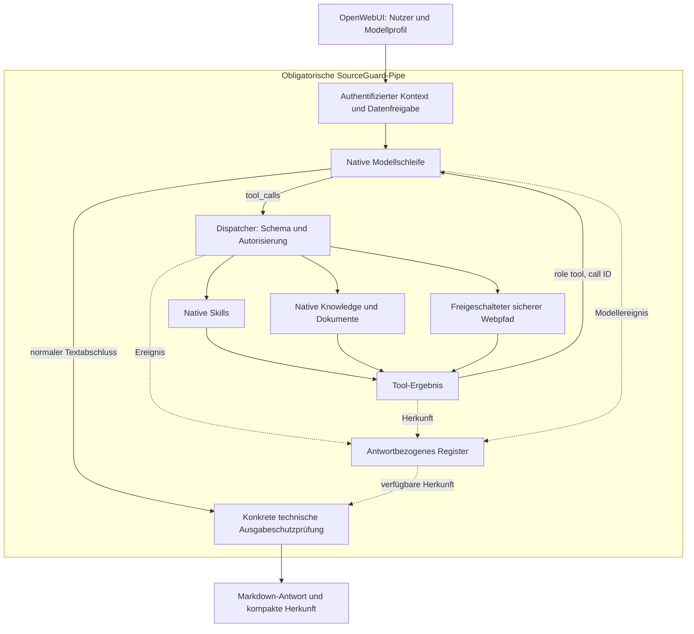

# THEOAgent v2 – Zielarchitektur (AP2.4)

Stand 28.11.2026 | SE-Revision 3 nach PO-Entscheidung zur vertrauenswürdigen Umgebung | Ausgangscommit e0c32023c7a70e69544cd164c3f374c31b3e9543. Keine Produktfreigabe, kein Implementierungsnachweis.

## 1. Entscheidung und Geltungsbereich

Eine obligatorische SourceGuard-Pipe im vorhandenen OpenWebUI (Referenz 0.11.4). Native Modellkommunikation über generate_chat_completion, zunächst google/gemma-4-31b-it direkt über OpenRouter. Native Skill-/Knowledge-Callables; sichere Webadapter nach Schutzvalidierung. Modell und Provider austauschbar innerhalb des Plattformvertrags, Requalifikation erforderlich. Keine zweite fachliche Entscheidungsinstanz, eigene Steuerungs-JSON-Grammatik, zusätzliche Agenten/DB/Dienste, feste Recherchefolge oder globales Antwortgate. DRS:KI-Integration DEFERRED/TO_CHECK, keine Behauptung gleichwertiger Integration. Vor DRS-Deployment nachweisen, abweichende Lösung nur mit PO-Entscheidung.

Verbindlich: [Baseline v2.0.0](../requirements/BASELINE.md), [Abnahmeprofil](../requirements/ACCEPTANCE_PROFILE.md), [PO-Fundstellenentscheidung](PO_FUNDSTELLENGENAUIGKEIT_2026-11-28.md). Technische Ausgestaltung [AP2.3](AP2_3_MINIMAL_PROTECTION.md); diese bleibt detaillierte Referenz. Die Review-Disposition in §8 konkretisiert; die spätere PO-Entscheidung und SE-Umsetzung in §9 haben bei technischen Widersprüchen Vorrang. Die freigegebene Baseline bleibt unverändert.

## 2. Komponenten

Logische Bausteine innerhalb einer Python-Pipe, keine Microservices. OpenWebUI-Konfiguration liefert Zielmodell, Benutzerkontext, Tool-Schemas/Callables, Fachprompt, Skillmanifest und zugelassene Datenquellen. Fachstandard, Prompt, Skills und Bibliothek bleiben außerhalb des Pipe-Codes wartbar. W2 kann fachliche Änderungen ohne Admin oder Programmierung vornehmen müssen; praktische Berechtigungsprüfung noch offen. Technische Berechtigungs- und Providerfreigaben bleiben Betreiberaufgabe (W3). W2-Modellwahl nur unter vorab technisch/rechtlich freigegebenen kompatiblen Modellen; keine Umgehung der Betreiberfreigabe.

## 3. Laufzeitvertrag

1. Vor Modellübermittlung authentifizierten Kontext, Betreiber-/Providerfreigabe und zugewiesene Datenbereiche feststellen. Bereits vor Pipe stattfindende Plattform-Datenflüsse (RAG, Embeddings, Tasks) gesondert prüfen/absichern. Unbekannte Rechte kein positiver Status. Dauerhaft sichtbarer Anonymisierungshinweis. Keine pauschale semantische Personendatenerkennung.
2. Nachrichten und autorisierte Konfiguration ohne fachlichen Klassifikator an Modell übergeben. Nur freigegebene native Tools exponieren. Kein Werkzeugzwang, auch ohne Tools zulässige N0-Aufträge bearbeiten. Benutzerquellenbeschränkung im Kontext erhalten; technisch eindeutigen Scope durchsetzen.
3. Native tool_calls validieren (Schema, Typen, eindeutige IDs, zulässige Aktion, effektiver Scope). Vor Zugriff autorisieren; unbekannte ACL nicht durch bekannte ID ersetzen. Aufruf ausführen, sichere Tool-Rückgabe mit identischer Call-ID übergeben. Bei Fehler nur betroffene Aktion sperren und konkreten Fehler melden. Untrusted Dokument-/Webinhalte erhalten keine Befehlsautorität. Kein unkontrollierter Fallback.
4. Wiederholen bis normaler Abschluss oder technischer Ressourcenbegrenzung. Aufruf-/Kontextbudgets konfigurierbar, keine Q-09-Zeitziele als Abbruchschwelle. Keine verpflichtende zweite Antwortphase; höchstens eine begründete zusätzliche Korrekturphase bei konkretem Problem. Keine ungeprüfte Zwischenantwort als sicheren Fallback verwenden.
5. Normalen Markdown-Text mit verfügbaren, tatsächlich zuordenbaren Herkunftsinformationen ausgeben. Technische Schutzprüfung nur konkret prüfbarer Geheimnisse, Freeze-Gleichheit und sonstiger eindeutig feststellbarer Schutzverletzungen; keine generelle semantische Freigabemaschine. Tragfähige zulässige Teilantworten erhalten, spezifische Einschränkungen bei fehlenden Voraussetzungen. Pipe-Totalausfall kein direkter Modellbypass.

## 4. Fachliche Qualität und technische Herkunft

N0–N4 sind fachliche Arbeitsregeln für Aussagen, keine technische Zustandsmaschine. Modell entscheidet Recherchebedarf, Quellenauswahl, Kontextlektüre, Interpretation, tatsächliche Belegfunktion. Originalwortlaut bei zugeschriebenen Zitaten prüfen; deterministisch exakten Vergleich nur dort einsetzen, wo ein eindeutig adressierter Wortlaut und zugänglicher Originaltext vorliegen. Keine pauschale Zitat-Regex oder obligatorische Zitatproduktion. Keine erfundenen Quellen, präzisen Referenzen oder Prüfbehauptungen. Exklusiver Quellenauftrag: kein Modellwissen als Ersatz. Fachliteratur: Werk/Autor und identifizierbarer Abschnitt genügen; Druckseiten optional, kein Seitenmapping. Normspezifische Referenzen unverändert.

Register erfasst Call-ID, vertrauenswürdigen Antwortbezug, Werkzeug, Status, Dauer, bei Textabruf Dokumentidentität/effektive URL, tatsächliche Rückgabegrenzen soweit vorhanden, Umfang und Übergabestatus. Angeforderte Grenzen getrennt von gelieferten Grenzen, unbekannt bleibt unbekannt. Keine Rohtexte in Diagnose; private Metadaten nur berechtigter Sitzung. Suche, TOC, Skill und Originaltext differenzieren. Abrufliste nicht mit tatsächlicher Belegverwendung gleichsetzen. Folgeturns: vorhandene vertrauenswürdige Antwortmetadaten verwenden, sonst fehlende Provenienz offenlegen; neue Recherche explizit neu. Sichtbarer Chattext ist kein manipulationssicheres Register. Plattformvertrag für Metadaten prüfen, keine neue DB.

Freeze: Nutzerbestätigte eindeutige Fassung/Passage und unabhängige Freigabe-/Schutzstatus im verfügbaren Arbeitskontext. Geschützten Text exakt übernehmen/vergleichen, betroffene unzulässige Änderung nicht ausgeben, andere Änderungen erhalten. Nur ausdrückliche Aufhebung; unklarer Status Rückfrage. Keine Persistenzbehauptung ohne Zugriff. Autoritative Statusführung und stabile Textgrenzen sind AP3-Implementierungsrisiko; keine Abnahme auf Grundlage bloßer Promptregel.

## 5. Evidenz und offene Risiken

| Gegenstand | Evidenz / Status |
|---|---|
| Native Modellschleife | AP2.1 PO-Live-Protokoll: synthetischer Roundtrip, 2 Modell-/1 Toolaufruf |
| Verfügbare Tools | AP2.2a: 37 injiziert, 7 erwartete Schemas/Callables vorhanden |
| Knowledge | AP2.2b L-01: 5 Modell-/4 Toolaufrufe, 9.125 s, 2 Textabrufe |
| Skill und Fehlerreaktion | L-02: 5 Modell-/5 Toolaufrufe, 11.4791 s, expliziter Skillauftrag, erneute Suche nach Fehler |
| Fachqualität | L-01/L-02 historische Gesamtbewertung PARTIAL; fachliche Wiedergabe L-02 positiv, Seitenfehler; keine nachträgliche Orakeländerung |
| Autonome Skillauswahl, tatsächliche Identität/Locator | Offen; Kommunikation belegt, keine semantische Verifikation |
| ACL, Datenfluss vor Pipe, SSRF, Secrets, Freeze | NOT_RUN; AP2.3 legt Schutzkonzept fest, nicht Sicherheitsnachweis |
| Plattformmetadaten, Anhänge aller Formate, W2-Rechte | Offen; gezielte Tests |
| Offline-Tests der Probes | Erstellt, NOT_RUN; kein bestandener Unit-Test behauptet |
| DRS:KI | DEFERRED/TO_CHECK |

Historische Quellen: [AP1](AP1_V2_COMPONENT_INVENTORY.md), [AP2.1](../../tests/runs/2026-11-28-AP2-NATIVE-TOOL-PROBE.md), [AP2.2a](../../tests/runs/2026-11-28-AP2-NATIVE-TOOL-INVENTORY.md), [L-01](../../tests/runs/2026-11-28-AP2-KNOWLEDGE-PROBE.md), [L-02](../../tests/runs/2026-11-28-AP2-KNOWLEDGE-PROBE-02.md). PO-Protokolle, keine eigene SE-Live-Ausführung.

## 6. Umsetzung in kleinen Inkrementen

AP3a: aus native_knowledge_probe_v2.py Adapter/Schleife wiederverwenden, minimale technische Regeln, Scope-/Datenflusskontrollen, Ereignisregister, sichere Fehlerpfade. Kein globales no_tools-Gate, keine Probe-Testdatenfreigabe als generelle Autorisierung. Synthetische Offline-Tests tatsächlich ausführen. AP3b: autorisierte Knowledge-/Skill-Wege und Plattformmetadaten gezielt live prüfen (A/B-Canaries, Nutzerrechte und Modellscope getrennt); Freeze und Folgeprovenienz. AP3c: sichere Webpfade; native Schutzwirkung nachweisen oder gehärtete Teilkomponenten des SourceGuard 0.2.3 wiederverwenden. Keine Freischaltung ungeprüfter Abrufpfade. AP2.3 enthält detaillierte Testfälle und Grenzen. Inkremente sind SE-Plan, keine neue Baseline. Keine Wiederholung des bereits nachgewiesenen reinen Kommunikationspfads ohne relevante Änderung.

AP4: acht frühe Live-Fälle V2-L01–08 aus Abnahmeprofil; fehlende Schutzvoraussetzungen vor einschlägigem Lauf klären, nicht als bestanden werten. AP5: versionierten Fachstandard festlegen, alte read_source/review_evidence-Verträge und Aktivierungsworkarounds minimal bereinigen, fachliche Konfiguration separat qualifizieren. Für AP4 notwendige technische Promptbereinigung bereits vorher. AP6: nur befundorientierte Änderungen. AP7: 30 Fälle/40 Läufe, mindestens 36 PASS, 40 sinnvolle Antworten unter vereinbarten Voraussetzungen, null schwere/harte Verstöße; separate Schutztests, Q-03/Q-08/Q-09/Q-11 unverändert. Fachliche Abnahme und Freigabe durch PO.

## 7. Review

Claude-Review des Stands 981c0b1 durch PO übermittelt: tragfähig mit Auflagen, 0 CRITICAL, 7 MAJOR, 3 MINOR. SE-Disposition nachfolgend; keine unabhängige Nachprüfung dieser Revision. QE prüft Architektur gegen Baseline, nicht Produktabnahme. Fokus auf tatsächliche Schutzgrenzen, offene Plattformverträge, minimale umsetzbare Lösungen und Erhalt fachlicher Nutzbarkeit. Findings mit Requirement, Beleg, Schwere, konkreter Abhilfe; keine neue Requirements-Baseline oder Repository-/Freigabehoheit. AP3 gestuft nach den folgenden Festlegungen.

## 8. SE-Disposition des Claude-Reviews (QE-01–10)

Reviewquelle: vom PO im Projektchat übermittelter vollständiger Bericht zu 981c0b1, statische Prüfung laut QE. Keine unabhängige Bestätigung seiner Annahmen zu OWUI 0.11.4. Nachfolgende Entscheidungen ergänzen §§2–6 verbindlich für den Entwicklungsentwurf; keine Produktfreigabe.

### Vor AP3a festgelegte Entscheidungen

- **QE-01 (MAJOR), angenommen:** Eine Manifold-Pipe mit je einem Eintrag pro W3-freigegebenem Zielmodell ist bevorzugt. W2 wählt ausschließlich diese Pipe-Einträge, nicht rohe Basismodelle. W3 beschränkt Rohmodellzugriffe, auch API und direkte IDs, für nicht berechtigte Nutzer. Prüfen, ob interner Pipe-Aufruf unter Nutzerkontext trotz Rohmodell-ACL autorisiert möglich ist; keine Admin-Impersonation oder ACL-Umgehung. Falls OWUI 0.11.4 dies nicht unterstützt, alternative sichere Plattformkonfiguration untersuchen; W2-Wechsel bis dahin nicht als erfüllt ausweisen. AP3a synthetisch mit festem Zielmodell möglich, keine Freischaltung ungesicherter Modellwechsel. RANF-07/Q-11/SP-01 bleiben verbindlich.
- **QE-02 (MAJOR), angenommen:** Zielprofil ohne automatische externe RAG-/Dateikontextübermittlung und ohne externe Tasks; Embeddings lokal. Tasks deaktivieren, falls nicht möglich ausschließlich separat autorisiertes lokales Modell und eindeutige Task-Erkennung; keine fachliche Tool-Schleife bei erkannten Tasks. Keine unkontrollierte externe Vorverarbeitung. Vorhandene native Lesepfade für Anhänge erhalten, RANF-06 praktisch prüfen. Plattforminjizierten Kontext nur bei belegbarer Autorisierung übernehmen, als Plattformkontext registrieren, nicht als eigenen Leseaufruf ausweisen. Unklarer Scope/Transport: betroffenen Datenfluss vor Sendung unterbinden; keine stille Weitergabe. Konfigurations-/Datenflussnachweis vor Live-Nutzung, auch vor der Pipe; OWUI-Version protokollieren.
- **QE-06 (MAJOR), angenommen mit Begrenzung:** Transiente Transport-/Providerfehler (429/5xx/Timeout) höchstens einmal wiederholen, sofern zulässig und kein Tool erneut ausgeführt wird. Bei Budgetende, nicht korrelierbaren IDs oder anhaltendem Fehler darf genau ein sinnvoller Abschlussaufruf ohne Tools mit sicheren bereits vorhandenen Ergebnissen und konkreter Einschränkung erfolgen, nur bei erreichbarem autorisiertem Modell und reserviertem Kontextbudget. Keine automatische zweite Phase nach regulärem Abschluss. Ungültige Call-Batches nicht an Provider weiterreichen; sichere vorherige Dialoggrenze nutzen. Wenn Abschluss nicht möglich, deterministische auftragsbezogene Einschränkung mit tatsächlich verfügbaren Abrufinformationen und nächstem Schritt; keine ungeprüfte Zwischenantwort. length/content_filter nicht als vollständiger Abschluss. Kein unkontrollierter Bypass. Retry/Abschluss/Korrektur begrenzt: höchstens ein zusätzlicher fachlicher Abschluss- oder Korrekturaufruf insgesamt, keine Kaskade.
- **QE-07 (MAJOR), angenommen:** Probe-PROMPT nicht übernehmen. Nur technischer Vertrag im Pipe-Code (Tool-Ergebnisse als Daten, technische Fehler, keine unbelegte Lesezusage). Fachliche Skillwahl, N0–N4 und Fundstellenform in W2-pflegbare Konfiguration. Keine Pflicht zur Skill-Lektüre. Fachstandard bleibt separate versionierte Referenz.
- **QE-08 (MINOR), angenommen mit Präzisierung:** Endantwort vor Ausgabe puffern; Fortschritt nur via unterstützte Statusereignisse ohne Rohtext. Geschlossene initiale Ausgabeprüfungen: bekannte Geheimnisse gezielt maskieren; bei adressierter eingefrorener Fassung exakte Prüfung bzw. unveränderte Wiedereinsetzung; Abschlussgrund prüfen. Kein allgemeines Zitaterkennungs-/Coverage-Gate. Nur bei nicht anders lösbarer Freeze-Abweichung eine begründete Korrekturphase innerhalb des oben genannten Budgets. Wortlautprüfung fachlich durch Modell/Skills anhand zugänglichen Originals; deterministischer Vergleich nur bei später nachgewiesenem Bedarf und eindeutig adressiertem Text, keine Voraussetzung für AP3a. Schutz vor Datenabfluss vor Modell-/Toolübermittlung unabhängig von Ausgabeprüfung.
- **QE-09 (MINOR), angenommen:** Register unterscheidet abgerufen, in Request gesendet, erfolgreicher Providerabschluss; gesendet beweist nicht vollständige Modellkontextverarbeitung oder fachliche Lektüre. Kontextbudget vor jeder Sendung anhand tatsächlicher Zielmodellgrenzen, konservativer Schätzung und reserviertem Ausgabebudget; kein pauschaler Zeichenbeschnitt, keine stillen Provider-Transforms/Kürzungen zulassen, soweit konfigurierbar nachweisen. Nicht verifizierbare Kürzungsmöglichkeit kenntlich machen, keine vollständige Kontextverarbeitung behaupten. usage.prompt_tokens soweit geliefert als Plausibilitätswert, kein Beweis. Bei Budgetüberschreitung sichere gezielte Kontextreduktion mit dokumentierten ausgelassenen Belegen oder Abschluss nach QE-06; keine ungekennzeichnete Vollständigkeitsbehauptung.

### AP3b – vor Implementierung des jeweiligen Mechanismus zu verifizieren

- **QE-03 (MAJOR), teilweise angenommen:** Primärer Träger ist der vorhandene serverseitige OWUI-Chatspeicher mit antwortbezogenen Quellenmetadaten, sofern persistierte Citation-/Event-Metadaten tatsächlich lesbar, autoritativ und nutzergebunden sind. Kurzer Spike: speichern, neu laden, Folgeturn, falsche Chat-/Message-ID, Bearbeitung und Zugriff anderer Nutzer. Keine Annahme, dass Event allein persistiert. Nur serverseitig vertrauenswürdige Felder als Evidenz; sichtbarer Chattext ist Kontext, kein Beweis. HMAC nicht vorab einführen; nur wenn eine nachgewiesene Integritätslücke dadurch wirklich geschlossen wird (Replay/Bindung beachten). Bei fehlendem Träger F-07-Einschränkung offenlegen; funktionale Pflicht bleibt offen, alternative bestehende Plattformmöglichkeit prüfen.
- **QE-04 (MAJOR), teilweise angenommen:** Freeze-Status muss autoritativ aus ausdrücklicher Nutzerbestätigung stammen. Bevorzugt bestehender OWUI-Bestätigungs-/Action-Mechanismus, wenn verfügbar; alternativ eindeutiger bestätigter Nutzerauftrag mit exakter Fassung/Passage aus vertrauenswürdigem Verlauf und nachvollziehbarer Statusführung. Stabiler Bezug auf Fassung/Abschnitt, Originaltext und unabhängige Status im vorhandenen serverseitigen Arbeitskontext. Nicht sämtliche Chatantworten per Teilstring prüfen: nur als Revision dieser Fassung identifizierte strukturierte Arbeitsblöcke, geschützte Teile unverändert zusammensetzen oder exakt positionsbezogen vergleichen. Ohne eindeutige Adressierung nur separaten Änderungsvorschlag, keine behauptete neue vollständige Fassung. Keine drei neuen Tools, HMAC-Blöcke oder eigener UI-Dialog vor Plattform-Spike festlegen. Prüfen, ob Bestätigung/Status/Revision ohne technische Nutzerbefehle realisierbar sind. Falls kein belastbarer Träger, Freeze nicht als technisch erfüllt ausweisen, keine Freigabe. H-04/Q-05 unverändert.

### AP3c – vor Webfreischaltung

- **QE-05 (MAJOR), angenommen mit Ergänzung:** Ein qualifizierter Webpfad, nicht zwei parallele Implementierungen. Native Schutzkette zuerst auf vorhandene belegbare Mechanismen prüfen, sonst gehärteten vorhandenen Downloader verwenden. URL-Herkunft: exakt vom Nutzer für Abruf autorisiertes Ziel oder aus vertrauenswürdiger Suchrückgabe dieses Laufs, nicht aus beliebigem Dokumenttext/Modellkonstruktion; Redirects separat sicher prüfen. Herkunft allein ist keine Freigabe vertraulicher URL-Inhalte. Vor jeder externen Suche und jedem Abruf Datenempfänger und zulässigen Datenumfang prüfen; keine freien externen Modell-Tool-Argumente mit vertraulichem Kontext, keine beliebig modellgenerierten Query-/Pfadparameter an Drittziele. Für nicht eindeutig freigegebene externe Datenflüsse nur synthetische/zulässige öffentliche Daten im Testprofil, sonst Web deaktiviert. Keine Behauptung, semantische Exfiltration allein durch URL-Herkunft oder Secret-Regex zu verhindern. Kontrollierte Injection-Canaries für Suchquery, URL-Pfad/Query und Redirect ergänzend zu SSRF. Web-PDF-Extraktion erst nach sicherem Abruf und autorisiertem lokalem Extraktionspfad; kein zweiter unkontrollierter Fetch. Detaillierte Freischaltprüfung AP3c.

### PO-Voraussetzung und Status

- **QE-10 (MINOR), angenommen, offen beim PO/Betreiber:** Historische L-01/L-02: Valve aktiviert, konkrete Rechte-/Providerfreigabegrundlage nicht dokumentiert; keine rückwirkende Freigabe ableiten, keine Testergebnisse umdeuten. Vor nächstem Live-Test mit geschützten Fachtexten oder personenbezogenen Daten konkrete Zulässigkeit für Sammlung, Provider und Datenfluss klären/dokumentieren. Bis dahin nur synthetische oder tatsächlich anonymisierte, zur Übermittlung zulässige Testdaten. Formale Datenschutzklärung lokal zurückgestellt, SP-01/05 nicht aufgehoben.

Alle zehn Findings disponiert, keine als technisch behoben behauptet. QE-01/02/06/07/08/09 Architekturentscheidungen für AP3a vorhanden; QE-03/04 Plattform-Spikes vor jeweiliger Implementierung; QE-05 vor Webfreischaltung; QE-10 vor nichtsynthetischem geschütztem Live-Test. Keine neue Baseline, keine weiteren Pflichtrecherchen, kein neues semantisches Gate. AP3a mit synthetischen Daten technisch aufnehmbar; keine Produktfreigabe, Schutztests NOT_RUN. Unabhängiger Nachreview dieser Revision nicht erfolgt.

## 9. PO-Entscheidung: vertrauenswürdige Betriebsumgebung (28.11.2026)

PO im Projektchat: „ich bin einverstanden: THEOAgent arbeitet in einer vertrauenswürdigen umgebung, die wir nicht speziell absichern müssen. wir gehen davon aus, dass die zielumgebung von drs:ki vertrauenswürdig und abgesichert ist“.

**Architekturannahme:** Vertrauenswürdiger Nutzerkreis, vertrauenswürdige und betreiberseitig abgesicherte Zielplattform DRS:KI. Keine eigene Hochsicherheits-, Audit-, Manipulationsschutz- oder redundante Infrastrukturarchitektur im Produkt. Die Annahme ist kein technischer Sicherheitsnachweis, keine nachträgliche Testfreigabe, keine Bestätigung konkreter Betreiberrechte oder Nutzungsrechte. Lokale Entwicklungsumgebung und externer Modellprovider sind nicht automatisch durch DRS:KI abgesichert.

**SE-Umsetzung (Vorrang vor überschießenden Maßnahmen aus §§6/8 und AP2.3):**

| Finding | Verhältnismäßige Lösung |
|---|---|
| QE-01 | Obligatorischer Pipe-Pfad innerhalb des THEOAgent-Profils, Modellwechsel über vorhandene Konfiguration bzw. Manifold sofern nötig. Keine plattformweite Rohmodellsperre als Produktfunktion. Q-11 und RANF-07 praktisch nachweisen. |
| QE-02 | Vorhandene Plattformkonfiguration und Betreiberfreigaben nutzen, keine pauschale Deaktivierung zugelassener Tasks/RAG/Embeddings allein aus Sicherheitsannahmen. Herkunft injizierter Kontexte korrekt kennzeichnen. Nicht freigegebene externe Datenflüsse bleiben unzulässig. |
| QE-03 | Native Quellenanzeige und verfügbarer Chatverlauf bevorzugt. Kompakte Antwort-Herkunft aus tatsächlichem Register. Keine eigene Persistenz, HMAC, Replay- oder Manipulationsschutztests. Ein normaler Folgeturn genügt als erster Funktionsnachweis; fehlende frühere Evidenz offenlegen, keine rückwirkende Lesezusage. |
| QE-04 | Explizite Nutzeranweisung und eindeutiger Arbeitskontext, Freigabe/Freeze getrennt; exakter Textvergleich bzw. unveränderte Übernahme bei eindeutig adressierten Passagen. Kein eigener Bestätigungsdialog oder signierte Blöcke. Bei unklarer Fassung keine behauptete geschützte Revision. Funktionstest T-05 bleibt. |
| QE-05 | Einen vorhandenen, betreiberseitig abgesicherten Webpfad bevorzugen. Keine eigene umfassende Anti-Exfiltrationsarchitektur, URL-Herkunftszwang oder doppelte Netzwerksicherung allein auf Verdacht. Wenn eigener Direktabruf implementiert wird, SP-03-Schutz des Abrufpfads sicherstellen; ungeklärte unzulässige Datenflüsse nicht freischalten. |
| QE-06/07/08/09 | Schlanke Fehlerbehandlung, fachliche Regeln außerhalb des Pipe-Codes, wenige konkrete technische Prüfungen, einfaches modellbezogenes Kontextbudget. Keine zusätzlichen Gates. |
| QE-10 | Rechte- und Providerklärung organisatorisch beim PO/Betreiber, kein zusätzliches technisches Freigabesystem. Bis zur Klärung der konkreten externen Testdatenübermittlung nur zulässige synthetische bzw. tatsächlich anonymisierte Daten. |

**Abgrenzung:** H-01–06, SP-01–06, Q-04/05/12 und die übrige Baseline bleiben verbindlich. Plattformseitig gewährleistete Schutzfunktionen werden nicht erneut implementiert; deren Voraussetzungen werden im Deployment geklärt, nicht als bestanden erfunden. Dokument-/Webanweisungen sind keine autoritativen Befehle; Geheimnisse, Rechte und pastorale Vertraulichkeit bleiben zu beachten. Keine zusätzliche Produkt-ACL, eigene Sicherheitsdatenbank, kryptografische Provenienz oder separate Sicherheitsagenten. Gezielte, im Abnahmeprofil bereits verbindliche Schutz-/Funktionsfälle bleiben; keine Ausweitung zu allgemeinem Penetrationstest der DRS-Infrastruktur. DRS:KI-Integration weiterhin DEFERRED/TO_CHECK. Die PO-Annahme ersetzt nicht den obligatorischen Integrationsnachweis vor DRS-Deployment.

AP3a: schlanker Core mit synthetischen Tests; AP3b: nutzbarer Quellen-/Arbeitskontext statt eigener Persistenz; AP3c: vorhandenen freigegebenen Webpfad integrieren. Keine Änderung der Baseline oder historischer Testberichte. Keine neue Codeänderung, kein Live-Test. Unabhängige Nachprüfung nicht erfolgt.
